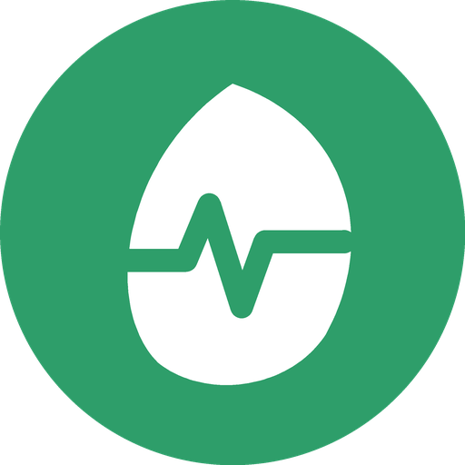

<p align="center">
  
</p>

<h1 align="center">Wellness</h1>

<p align="center">
  An open-source, offline-first health tracker for Android.<br/>
  Food · Water · Steps &amp; workouts · Blood pressure · Body composition · Pantry · Health tips
</p>

<p align="center">
  <a href="https://github.com/timmylich/wellness/releases/latest"></a>
  <a href="https://github.com/timmylich/wellness/actions/workflows/ci.yml"></a>
  <a href="LICENSE"></a>
  
  <a href="https://github.com/timmylich/wellness/releases"></a>
</p>

<p align="center">
  <b>No ads · No accounts · No analytics · No Google services · Your data stays on your phone</b>
</p>

<p align="center">
  <a href="https://github.com/timmylich/wellness/releases/latest"><b>⬇ Download APK</b></a> ·
  <a href="#support-the-project">❤ Support</a> ·
  <a href="#по-русски">🇷🇺 По-русски</a>
</p>

---

<!-- Screenshots: put PNGs into docs/screenshots/ (1080×2400 works well) and uncomment.
<p align="center">
  
  
  
  
</p>
-->

## Features

- **Food** — 12 daily scales (calories, protein, fat, carbs, sugar, added sugar, sodium, fibre,
  saturated and trans fat, cholesterol, potassium) with personal minimum, target and maximum,
  computed from your profile, goal pace and today's activity. Limit-only nutrients show a limit.
- **Fast food logging without AI** — recent foods, favourites, a bundled offline database
  (CIS dishes plus ~2300 European foods from ANSES-CIQUAL), [Open Food Facts](https://openfoodfacts.org)
  and USDA search, barcodes, counting by pieces, custom foods based on an existing product,
  editable log entries and importable food packs.
- **Energy balance** — intake vs expenditure (BMR × lifestyle + workouts + steps), surplus or
  deficit converted into estimated fat mass; optional adaptive targets.
- **Water** — one big button for water and a separate one for other drinks, charts, recommended
  range and a clearly marked dangerous amount (hyponatremia).
- **Activity** — background step counting from the phone's hardware sensor (no Google Fit
  needed) or Health Connect, MET-based workout templates, custom workouts.
- **Heart** — blood pressure and pulse log with ACC/AHA classification and heart-rate zones.
- **Body** — weight trend (time-weighted average), body fat (measured, US Navy or BMI-based
  estimate), BMI, waist-to-height ratio, healthy weight range.
- **Pantry** (optional) — what you have at home, purchase and expiry dates, a freshness bar,
  how much is left, nutrition tags and a reminder the day before a product expires.
- **Tips** — fresh air, drinking water, cancer prevention, sun, back health, sleep, nutrition.
- **Yours to configure** — English and Russian, sections on/off, theme and accent colour,
  animations, goal pace slider, custom nutrient limits, JSON export/import.

Every formula and limit cites its source (WHO, IOM/EFSA, ACC/AHA, USDA…) in
[`src/lib/calc.ts`](src/lib/calc.ts) and is covered by unit tests.

## Install

Download the APK from [Releases](https://github.com/timmylich/wellness/releases/latest) and open
it on your phone (allow installing from your browser or file manager when asked). The app can
notify you about new versions (Settings → Notifications). An F-Droid listing is planned.

## Privacy

All data is stored only on the device. Optional network requests:

| Request | What is sent | Can be turned off |
| --- | --- | --- |
| Food search (Open Food Facts, USDA) | the search text or barcode | Settings → Food |
| Update check (GitHub Releases) | nothing but a request to `api.github.com` | Settings → Notifications |

Health Connect access is optional and read-only (steps). There are no analytics, crash
reporters, ads or Google Play services in the app.

## Tech

- [Expo](https://expo.dev) SDK 57 · React Native 0.86 · TypeScript · Expo Router
- Hand-written SVG charts (`react-native-svg`), a ~100-line store on `useSyncExternalStore`
- A small local Kotlin module (`modules/wellness-native`) for the step counter service, local
  notifications and nested-gesture handling
- Typed i18n dictionaries (`src/i18n`), [Lucide](https://lucide.dev) icons

See [docs/architecture.md](docs/architecture.md) for a tour of the code.

## Build from source

Requirements: Node 20+, JDK 17–21, Android SDK.

```bash
npm install
npm run android                         # dev build on a device or emulator
npx expo prebuild --platform android    # generate the native project
npm run build:apk                       # → android/app/build/outputs/apk/release/
npm run check                           # typecheck + lint + tests (also run in CI)
```

The `android/` folder is generated (Continuous Native Generation) and not committed; configure
native behaviour in `app.json`. Releases are built by GitHub Actions — see
[docs/releasing.md](docs/releasing.md).

## Support the project

Wellness is free and built in spare time. If it helps you:

- ⭐ [Star the repository](https://github.com/timmylich/wellness) — it helps others find it
- 💳 Donate via Tribute (cards, crypto, SBP): [in Telegram](https://t.me/tribute/app?startapp=dRVs) · [in the browser](https://web.tribute.tg/d/RVs)
- 📣 Follow the author on Telegram: [@timmylich_portfolio](https://t.me/timmylich_portfolio)

<details>
<summary>Crypto addresses</summary>

| Network | Address |
| --- | --- |
| Ethereum and EVM networks (BNB Chain, Base, Arbitrum, Optimism, Polygon) | `0xe790989b801ddbc706f391b10bec0e6c1a1fd334` |
| Solana | `HJq4ocLn8eua95WKQs82N4hZ2S7VABANefTrSoUqo6rb` |
| TRON | `TMKejJ5a5unasnZiVZ1Vz8GvkXsDj7mvPE` |
| TON (Gram, W5 wallet) | `UQCOymZAvj5ho73JlD1s1-qo-pD-bqIQ-H_Y4FEjX7Sp68rI` |

Double-check the network before sending.
</details>

## Contributing

Code, translations, food data and health tips are welcome — see [CONTRIBUTING.md](CONTRIBUTING.md).

## Medical disclaimer

Wellness is not a medical device. Recommendations are general guidelines for healthy adults and
do not replace a doctor's advice.

## License

Wellness is free software: you can redistribute and modify it under the terms of the
[GNU Affero General Public License v3](LICENSE). Modified versions you distribute (or run as a
network service) must be released under the same license with their source code.

Food data: Open Food Facts — [ODbL](https://opendatacommons.org/licenses/odbl/1-0/);
ANSES-CIQUAL 2020 — [Etalab Open Licence 2.0](https://www.etalab.gouv.fr/licence-ouverte-open-licence/).
Icons: Lucide (ISC).

---

## По-русски

**Wellness** — бесплатный трекер здоровья с открытым кодом. Без рекламы, регистрации, слежки и
сервисов Google: все данные хранятся только на телефоне.

- **Еда**: 12 шкал с личными диапазонами (минимум — цель — максимум), офлайн-база продуктов,
  поиск в Open Food Facts и USDA, штрихкоды, счёт по штукам, свои продукты на основе готовых,
  редактирование записей, энергобаланс, советы.
- **Вода**: большая кнопка для воды и отдельная для напитков, графики, норма и опасный объём.
- **Активность**: фоновый подсчёт шагов датчиком телефона (без Google Fit) или Health Connect,
  шаблоны тренировок.
- **Сердце**: давление и пульс, классификация, пульсовые зоны.
- **Тело**: вес со взвешенным средним, % жира, талия, ИМТ, подходящий вес.
- **Продукты** (по желанию): что есть дома, сроки годности, полоса свежести, сколько осталось,
  метки состава и напоминание за день до окончания срока.
- **Советы**: воздух, вода, профилактика рака, солнце, спина, сон.

**Установка**: скачайте APK со страницы [Releases](https://github.com/timmylich/wellness/releases/latest).

**Поддержать автора**: ⭐ [звезда на GitHub](https://github.com/timmylich/wellness) ·
💳 Tribute — карты, крипта, СБП ([в Telegram](https://t.me/tribute/app?startapp=dRVs),
[в браузере](https://web.tribute.tg/d/RVs)) · 📣 [Telegram-канал](https://t.me/timmylich_portfolio).
Адреса криптокошельков — в разделе [Support the project](#support-the-project).

Лицензия — [GNU AGPL v3](LICENSE): код можно использовать и изменять, но любые распространяемые
изменённые версии обязаны оставаться открытыми под той же лицензией.
